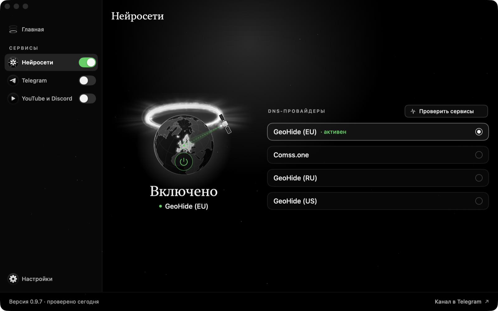

<h1 align="center">Nimb</h1>

<p align="center">ChatGPT, Claude, YouTube, Discord и Telegram там, где они не открываются.<br>Бесплатное приложение для Mac. Одна кнопка.</p>

<p align="center">
  <a href="https://github.com/Dizrane/Nimb/releases/latest"><b>Скачать</b></a> ·
  <a href="https://t.me/NimbProject">Новости в Telegram</a>
</p>

<p align="center"></p>

## Что делает Nimb

Три сервиса, каждый включается переключателем, а кнопка «Включить всё» запускает все сразу.

| | |
|---|---|
| **Нейросети** | ChatGPT, Claude, Gemini, Grok и ElevenLabs открываются, даже если закрыты по региону. Nimb включает бесплатный Smart DNS и сам подсказывает, какой из четырёх работает у вас лучше. Это не VPN: через сервис идут только запросы адресов сайтов. |
| **Telegram** | Прокси на вашем Mac ускоряет Telegram Desktop там, где он грузится медленно или не открывается. Подключается одним подтверждением в Telegram. |
| **YouTube и Discord** | Собственный защищённый туннель Cloudflare WARP. Вместе с ними открывается ещё около тридцати сайтов, например Instagram, WhatsApp, Facebook, X и LinkedIn (список есть в приложении). |

Остальное сделано, чтобы не мешать: первая настройка по шагам, значок в строке меню, работа с закрытым окном, уведомление о новой версии, обновление и полное удаление в один клик.

## Установка

1. Скачайте `Nimb-….dmg` на [странице релиза](https://github.com/Dizrane/Nimb/releases/latest) и перетащите Nimb в «Программы».
2. Откройте его. При первом запуске macOS скажет, что не может проверить приложение: у бесплатного проекта нет платной подписи Apple. Откройте «Системные настройки» → «Конфиденциальность и безопасность» и нажмите **Всё равно открыть** (на macOS 14 и старше достаточно правого клика → «Открыть»). Это один раз.

Или одной командой в «Терминале»:

```sh
curl -fsSL https://raw.githubusercontent.com/Dizrane/Nimb/main/scripts/install.sh | sh
```

Нужна macOS 13 или новее. Работает на Apple Silicon и Intel.

## Это безопасно?

- **Код открыт.** Всё, что делает Nimb, можно прочитать в этом репозитории, а приложение собрать самому (`./scripts/build_app.sh`).
- **Ни аккаунтов, ни рекламы, ни слежки.** В сеть уходят только проверка новых версий на GitHub и кнопка «Сообщить о проблеме», и только когда вы сами её нажали: перед отправкой видно, что именно уйдёт, а паролей, ключей и IP-адресов в отчёте нет.
- **Пароль вводите в окне macOS.** Он нужен, только чтобы поменять DNS и запустить туннель. Nimb его не видит и не хранит. Окно может называться «osascript»: так macOS подписывает запрос, который делает Nimb. Можно разрешить эти два действия без пароля и забрать разрешение в любой момент в «Настройках».
- **Файл можно проверить.** У каждого релиза указана контрольная сумма SHA-256 (`shasum -a 256 Nimb-….dmg`). Обновления внутри приложения проверяют её и подпись сами.
- **Удаляется без следов.** «Настройки» → «Удалить Nimb» возвращает DNS как был, удаляет туннель и его аккаунт Cloudflare, правила и все файлы.

## Что нужно знать

- Пока включён туннель, весь интернет-трафик Mac идёт через Cloudflare WARP, как в официальном приложении 1.1.1.1. Когда он не нужен, выключите переключатель.
- Бесплатные DNS-сервисы иногда перестают работать у кого-то. Тогда нажмите «Проверить сервисы» и выберите другой.
- Туннель не поможет там, где сервис сам закрыт для российских IP-адресов.
- Если на Mac включён VPN, он может перекрывать настройки Nimb.
- В Firefox по умолчанию включён «DNS через HTTPS» (в России с 2022 года): браузер спрашивает адреса у Cloudflare и обходит DNS Nimb. Выключите его в «Настройках» Firefox → «Приватность и защита». Nimb подскажет об этом сам.

## На чём это построено

Nimb не создаёт эти сервисы, а собирает их в одном приложении. Права и заслуги принадлежат их авторам.

- DNS: [GeoHide](https://geohide.ru) и [Comss.one](https://comss.one)
- Туннель: [Cloudflare WARP](https://one.one.one.one) и [amneziawg-go](https://github.com/amnezia-vpn/amneziawg-go) (Amnezia, MIT)
- Прокси для Telegram: основан на [TG WS Proxy](https://github.com/Flowseal/tg-ws-proxy) (Flowseal, MIT)
- Идея: [hb-ai-xbox-dns](https://github.com/neiroseti-ai/hb-ai-xbox-dns) для Windows

Тексты лицензий: [THIRD-PARTY-NOTICES.md](THIRD-PARTY-NOTICES.md). Проект не связан с GeoHide, Comss.one, Cloudflare, Telegram, Discord и YouTube; доступ через сторонние сервисы может пропасть. Всё, что вы делаете с программой, вы делаете на свой риск.

## Откуда скачивать

Только отсюда и из канала [@NimbProject](https://t.me/NimbProject). Nimb всегда бесплатный: если вам предлагают купить его или скачать где-то ещё, это не мы. Разработчик: [@i17th](https://t.me/i17th).

<sub>Лицензия кода: [PolyForm Noncommercial 1.0.0](LICENSE) (читать, использовать и изменять можно, продавать нельзя). Версии до 0.3.1 выпущены под MIT. Для разработчиков: `./scripts/test.sh` запускает проверки.</sub>
